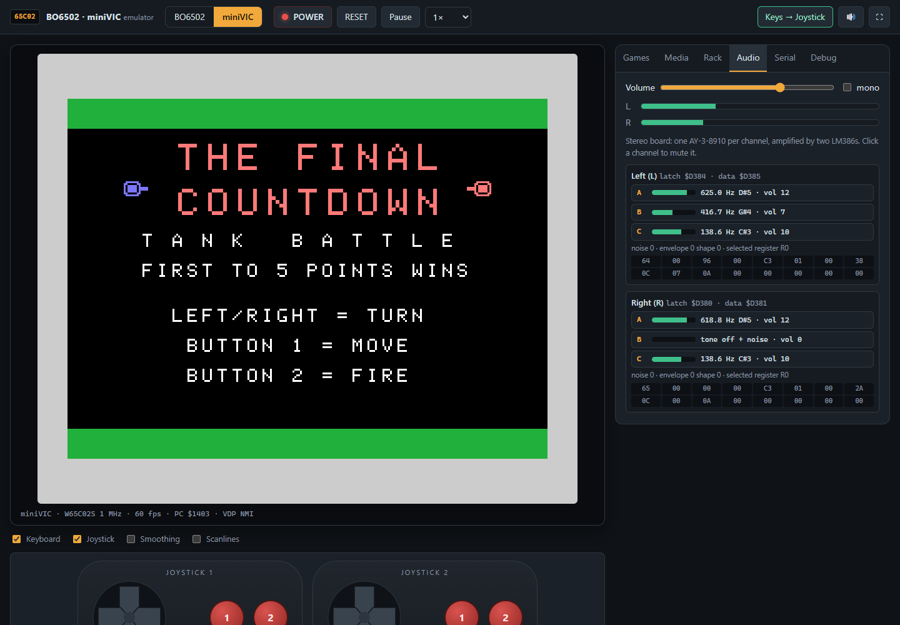

# BO6502 · miniVIC Emulator


A browser emulator for the **[BO6502](https://github.com/Boogs77/BO6502_65C02-based_modular_computer)** modular computer and for the **miniVIC**, its compact arcade-oriented sibling. Pick the machine, plug the boards into the rack, power it on and play the **[miniVIC games](https://github.com/Boogs77/miniVIC_games)** with stereo sound, an on-screen keyboard and two clickable joysticks.

### ▶️ [Play online](https://boogs77.github.io/BO6502-miniVIC-emulator/)

<p align="center"></p>

---

## ✨ Features

* **Two machines**: switch between **BO6502** (configurable rack) and **miniVIC** (fixed layout) with one click.
* **Real BIOS**: boots the miniVIC BIOS 24.10.26 (WozMon, Microsoft BASIC 1977, SD programs menu).
* **Accurate TMS9918A**: scanline renderer, all video modes, 32 sprites with the 4-per-line limit, 5th sprite flag, collisions, early clock, magnification, real port latch/read-ahead behaviour and vblank interrupt.
* **True stereo audio**: two **AY-3-8910** emulated at counter level (tone, 17-bit noise LFSR, 16 envelope shapes, measured logarithmic DAC), cycle-synchronised with the CPU and played through Web Audio.
* **Clickable input**: PS/2 keyboard and two Sega Master System joysticks drawn on screen, usable with mouse or touch; physical keyboard and gamepads work too.
* **SD card**: SPI bit-banged SD emulation, `.img` support and an SD image builder compatible with `make_sd.py`.
* **Display boards**: Big LCD T6963 (160x128 graphics and text), legacy HD44780 16x2 LCD and the 16-LED test board, each with a ready-to-run demo.
* **Debugger**: CPU registers, disassembly, step / frame, breakpoints, memory and VRAM viewer, VDP, VIA and AY registers.

---

## 🧠 Emulated Hardware

| Board | Chip | BO6502 | miniVIC |
| :--- | :--- | :---: | :---: |
| **CPU** | W65C02S (full WDC + Rockwell set, exact cycles) | 0.5 / 1 / 2 MHz | 1 MHz |
| **RAM** | HM62256LP 32KB | `$0000-$7FFF` | `$0000-$7FFF` |
| **ROM** | AT28C256 32KB (I/O pages excluded) | `$8000-$FFFF` | `$8000-$FFFF` |
| **VDU** | TMS9918A | `$B000` · IRQ | `$B000` · NMI |
| **Serial I/O** | W65C51 ACIA | `$C000` | `$C000` |
| **KEYb** | W65C22 + PS/2 (raw set 2 scancodes) | `$D180` | `$D180` |
| **Joystick** | W65C22 + 2x DB9 (Sega) | `$D1A0` | `$D580` |
| **SD Card** | W65C22 SPI bit-bang | `$D1B0` | `$DD80` |
| **Audio** | 2x AY-3-8910 stereo | `$D1C0` | `$D380` |
| **Big LCD** | W65C22 + Toshiba T6963C, 160x128 | `$D190` | — |
| **Legacy LCD** | W65C22 + HD44780U 16x2 (4 or 8 bit) | `$D000` | — |
| **LED test** | W65C22 + 16 LEDs | `$D000` | — |

On the BO6502 every board can be removed, moved to a different base address and wired to IRQ or NMI, just like the jumpers on the real modules.

---

## 🎮 Controls

| Input | Joystick 1 | Joystick 2 |
| :--- | :--- | :--- |
| **Keyboard** (mode "Keys → Joystick") | Arrows · Z / Space = 1 · X = 2 | W A S D · F = 1 · G = 2 |
| **Mouse / touch** | on-screen pad | on-screen pad |
| **Gamepad** | first pad | second pad |

In "Keys → Keyboard" mode the physical keyboard drives the PS/2 keyboard (US layout, as in the BIOS scancode table).

---

## 🛠️ Build & Run

Requires **Node.js 18+**.

```bash
npm install
npm run dev      # http://localhost:5173
npm run build    # static site in dist/
npm test         # CPU (Klaus Dormann suites), chips, full miniVIC boot from SD
```

The test suite runs the real BIOS headless, loads a game from the emulated SD card and saves screenshots in `tests/out/`.

---

## 📁 Project Structure

| Folder | Content |
| :--- | :--- |
| `src/cpu` | W65C02S core and disassembler |
| `src/devices` | TMS9918A, AY-3-8910, W65C22, W65C51, SD card, PS/2 keyboard |
| `src/boards` | BO6502 / miniVIC boards and their address decoding |
| `src/core` | bus, interrupts, NTSC frame timing |
| `src/ui` | screen, terminal, virtual keyboard, joysticks, panels |
| `public` | default ROM and games |

---

## 🔗 Useful Links & Resources

* **BO6502 System:** [65C02-based Modular Computer](https://github.com/Boogs77/BO6502_65C02-based_modular_computer)
* **miniVIC Games:** [65C02 Arcade Collection](https://github.com/Boogs77/miniVIC_games)
* **miniPET:** [The sister project](https://github.com/Boogs77/miniPET_65c02)
* **CPU tests:** [Klaus Dormann 6502/65C02 functional tests](https://github.com/Klaus2m5/6502_65C02_functional_tests)

> The default ROM contains Microsoft BASIC 1977 (built from [mist64/msbasic](https://github.com/mist64/msbasic)) and WozMon, for educational and hobby use.

---
*Created by Boogs77 - 2026*
